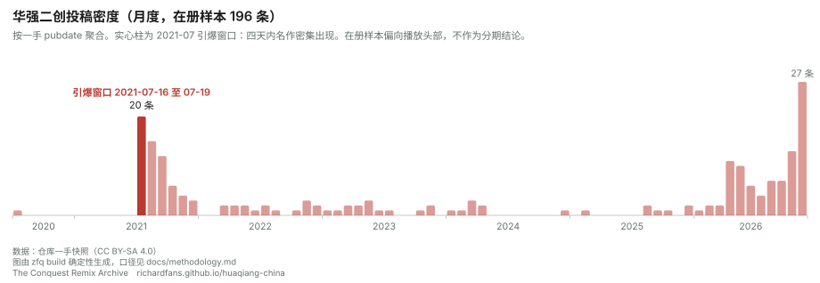

# 🍉 The Conquest Remix Archive · 征服二创宇宙档案

> An open, reproducible research archive that **collects, organizes and tracks** the
> derivative-work universe around *The Conquest* (《征服》, 2003) — the TV drama behind
> one of China's most beloved internet memes: **Liu Huaqiang buying a watermelon**
> (“你这瓜保熟吗？” — “Is this melon *guaranteed ripe*?”).
> Conventional wisdom on Bilibili holds that humanity has unlocked less than 0.1% of
> Huaqiang's potential. This archive keeps the ledger.
> **中文 → [README.md](README.md)** ｜ 🌐 Site: [richardfans.github.io/huaqiang-china](https://richardfans.github.io/huaqiang-china/)

[](https://richardfans.github.io/huaqiang-china/)
[](docs/decisions/0009-development-metric.md)
[](https://github.com/RichardFans/huaqiang-china/actions/workflows/ci.yml)
[](LICENSE.content)

<p align="center">
  
</p>

## What is this?

In November 2026, the author ran into yet another new watermelon-scene remix on
Bilibili — from *Sa Ri Lang* to AI covers, five years on, the meme keeps sprouting
new forms while nobody keeps a systematic record of it.

This project is not a tech demo. It does one simpler thing: **organize** this ongoing
piece of Chinese internet culture, keep **tracking** its evolution, and **share** it
with more people — including the world beyond Bilibili. The means happen to be open
source: every entry carries a timestamped evidence chain, and every leaderboard is
regenerated from data by the pipeline.

## About the author

The author is a Bilibili premium member who has watched Huaqiang remixes over meals
for years. This is a hobby-powered, non-commercial project with no platform
affiliation. Spotted an error, or a creator wanting to fact-check your own entry?
Issues welcome: [submit](.github/ISSUE_TEMPLATE/submit_video.yml) ·
[correction](.github/ISSUE_TEMPLATE/correction.yml) ·
[takedown](.github/ISSUE_TEMPLATE/takedown.yml).

<!-- zfq:generated:start -->
**196 derivative works catalogued** (Hall 17 · Hot 133 · Rising 46 · Seed 0) ｜ Human-reviewed 0 · Pending 196 (⚠) ｜ Data snapshot 2026-11-28 (UTC)
> Folk wisdom: humanity has unlocked less than 0.1% of Huaqiang's potential. This archive tried to compute a reproducible version and hit a ceiling: search exposes at most 1,000 results per keyword (5 keywords measured, all capped). The denominator is unknowable; the ledger holds 196 entries and keeps counting ([ADR-0009](docs/decisions/0009-development-metric.md))

## 🏆 Hall of Fame (≥ 10M views, 17 works)
| # | Work | Creator | Published | Views | Coins | Form | Scene |
|---|---|---|---|---|---|---|---|
| 1 | [⚡萨 日 朗！！！⚡](https://www.bilibili.com/video/BV15L411p7M8) ⚠ | [夜雨星繁y](https://space.bilibili.com/39422678) | 2021-07 | 51,190,783 | 1,317,032 | Fan edit | Watermelon scene |
| 2 | [无 伤 反 杀 刘 华 强](https://www.bilibili.com/video/BV1qb4y1z7ve) ⚠ | [特效小哥studio](https://space.bilibili.com/3066511) | 2021-08 | 24,045,659 | 593,832 | Fan edit | Watermelon scene |
| 3 | [买 瓜 大 队](https://www.bilibili.com/video/BV1CU4y137FJ) ⚠ | [小猪要吃好果子](https://space.bilibili.com/445423006) | 2021-07 | 22,973,802 | 244,451 | Fan edit | Watermelon scene |
| 4 | [《内 向 顾 客》](https://www.bilibili.com/video/BV1Wv411n7FK) ⚠ | [无牙人](https://space.bilibili.com/509993026) | 2021-07 | 15,954,646 | 216,767 | Fan edit | Watermelon scene |
| 5 | [你 真 敢 开 枪 啊 ？](https://www.bilibili.com/video/BV17w411R7Eb) ⚠ | [干物快乐宅](https://space.bilibili.com/2074416895) | 2021-07 | 15,274,355 | 74,521 | Fan edit | Watermelon scene |
| 6 | [超 级 压 缩 毛 巾](https://www.bilibili.com/video/BV1184y1W79V) ⚠ | [伊介书生](https://space.bilibili.com/91790758) | 2022-12 | 15,027,612 | 175,386 | Fan edit | Watermelon scene |
| 7 | [郝 哥 不 在](https://www.bilibili.com/video/BV1RwdhBmE3M) ⚠ | [岩罗Crv](https://space.bilibili.com/438256074) | 2026-04 | 14,937,296 | 412,950 | Fan edit | Watermelon scene |
| 8 | [哥 谭 厨 师](https://www.bilibili.com/video/BV1Sf4y1T78M) ⚠ | [一大筐会飞的草莓](https://space.bilibili.com/36438715) | 2021-11 | 14,177,764 | 129,852 | Fan edit | Watermelon scene |
| 9 | [《无实物表演》](https://www.bilibili.com/video/BV1NhRMBiEcy) ⚠ | [酸奶煎个蛋](https://space.bilibili.com/50391034) | 2026-05 | 14,175,586 | 64,745 | Fan edit | Watermelon scene |
| 10 | [特效炸裂！年度之战！特效小哥大战建模小哥4](https://www.bilibili.com/video/BV1k34y1z7Y6) ⚠ | [特效小哥studio](https://space.bilibili.com/3066511) | 2021-12 | 13,541,738 | 2,253,937 | Fan edit | Watermelon scene |
| 11 | [这个玩具也太会扭了吧！根本停不下来~哈哈哈哈](https://www.bilibili.com/video/BV1vv411P7CJ) ⚠ | [机智的Kason](https://space.bilibili.com/8549577) | 2021-09 | 12,634,889 | 158,799 | Fan edit | Watermelon scene |
| 12 | ["只有这样，才知道你比的是厨师比赛"](https://www.bilibili.com/video/BV1kx4y1V78T) ⚠ | [一大筐会飞的草莓](https://space.bilibili.com/36438715) | 2023-02 | 12,190,415 | 263,687 | Fan edit | Watermelon scene |
| 13 | [水果摊的刀竟然沾糖水？](https://www.bilibili.com/video/BV1RyAVecEJA) ⚠ | [周小闹是周小闹](https://space.bilibili.com/3546640096954436) | 2025-02 | 11,778,214 | 2,064 | Fan edit | Watermelon scene |
| 14 | [《无能的郝哥》](https://www.bilibili.com/video/BV1kLRXBsE84) ⚠ | [增殖的发呆](https://space.bilibili.com/13641305) | 2026-05 | 11,571,836 | 108,918 | Fan edit | Watermelon scene |
| 15 | [《梗王之王》多少梗，快来快来数一数，24678...](https://www.bilibili.com/video/BV1Ku411B7XR) ⚠ | [谭乔](https://space.bilibili.com/330415548) | 2022-03 | 11,253,413 | 215,977 | Fan edit | Watermelon scene |
| 16 | [没 经 费 了](https://www.bilibili.com/video/BV1sP4y1W7Yt) ⚠ | [康师傅红烧甜不辣](https://space.bilibili.com/32837037) | 2021-08 | 10,723,473 | 290,001 | Fan edit | Watermelon scene |
| 17 | [【互动视频】选择角色，结局由你来定！](https://www.bilibili.com/video/BV1vb4y1r7cg) ⚠ | [Captive柠檬](https://space.bilibili.com/398622703) | 2021-08 | 10,265,972 | 234,477 | Fan edit | Watermelon scene |

## 🍉 The Watermelon Scene · Top 10
| # | Work | Creator | Published | Views | Coins | Form | Scene |
|---|---|---|---|---|---|---|---|
| 1 | [⚡萨 日 朗！！！⚡](https://www.bilibili.com/video/BV15L411p7M8) ⚠ | [夜雨星繁y](https://space.bilibili.com/39422678) | 2021-07 | 51,190,783 | 1,317,032 | Fan edit | Watermelon scene |
| 2 | [无 伤 反 杀 刘 华 强](https://www.bilibili.com/video/BV1qb4y1z7ve) ⚠ | [特效小哥studio](https://space.bilibili.com/3066511) | 2021-08 | 24,045,659 | 593,832 | Fan edit | Watermelon scene |
| 3 | [买 瓜 大 队](https://www.bilibili.com/video/BV1CU4y137FJ) ⚠ | [小猪要吃好果子](https://space.bilibili.com/445423006) | 2021-07 | 22,973,802 | 244,451 | Fan edit | Watermelon scene |
| 4 | [《内 向 顾 客》](https://www.bilibili.com/video/BV1Wv411n7FK) ⚠ | [无牙人](https://space.bilibili.com/509993026) | 2021-07 | 15,954,646 | 216,767 | Fan edit | Watermelon scene |
| 5 | [你 真 敢 开 枪 啊 ？](https://www.bilibili.com/video/BV17w411R7Eb) ⚠ | [干物快乐宅](https://space.bilibili.com/2074416895) | 2021-07 | 15,274,355 | 74,521 | Fan edit | Watermelon scene |
| 6 | [超 级 压 缩 毛 巾](https://www.bilibili.com/video/BV1184y1W79V) ⚠ | [伊介书生](https://space.bilibili.com/91790758) | 2022-12 | 15,027,612 | 175,386 | Fan edit | Watermelon scene |
| 7 | [郝 哥 不 在](https://www.bilibili.com/video/BV1RwdhBmE3M) ⚠ | [岩罗Crv](https://space.bilibili.com/438256074) | 2026-04 | 14,937,296 | 412,950 | Fan edit | Watermelon scene |
| 8 | [哥 谭 厨 师](https://www.bilibili.com/video/BV1Sf4y1T78M) ⚠ | [一大筐会飞的草莓](https://space.bilibili.com/36438715) | 2021-11 | 14,177,764 | 129,852 | Fan edit | Watermelon scene |
| 9 | [《无实物表演》](https://www.bilibili.com/video/BV1NhRMBiEcy) ⚠ | [酸奶煎个蛋](https://space.bilibili.com/50391034) | 2026-05 | 14,175,586 | 64,745 | Fan edit | Watermelon scene |
| 10 | [特效炸裂！年度之战！特效小哥大战建模小哥4](https://www.bilibili.com/video/BV1k34y1z7Y6) ⚠ | [特效小哥studio](https://space.bilibili.com/3066511) | 2021-12 | 13,541,738 | 2,253,937 | Fan edit | Watermelon scene |

→ Full list (112): [docs/lists/scene-maigua.md](docs/lists/scene-maigua.md) ｜ [Site](https://richardfans.github.io/huaqiang-china/scene/maigua/)

## 🍜 Song Laohu’s Banquet · Top 10
| # | Work | Creator | Published | Views | Coins | Form | Scene |
|---|---|---|---|---|---|---|---|
| 1 | [胡 言 乱 语](https://www.bilibili.com/video/BV15q4y197TJ) ⚠ | [小朱佩琪66](https://space.bilibili.com/430362460) | 2021-08 | 7,730,570 | 82,419 | Fan edit | Banquet scene |
| 2 | [华强见宋老虎 但是唱跳RAP 【多梦综合征】【AI音乐宇宙】](https://www.bilibili.com/video/BV1Hy4k64Erk) ⚠ | [多梦综合征](https://space.bilibili.com/110071473) | 2026-08 | 7,104,103 | 256,785 | Fan edit | Banquet scene / Watermelon scene |
| 3 | [【梗百科】控告律师是啥梗？扣税国王的后继梗？](https://www.bilibili.com/video/BV1dA4m1c7XM) ⚠ | [梗百科](https://space.bilibili.com/1544008396) | 2024-04 | 6,010,139 | 4,603 | Fan edit | Banquet scene |
| 4 | [这是我弟弟 我的刀盾](https://www.bilibili.com/video/BV1vnftBUErw) ⚠ | [伊介书生](https://space.bilibili.com/91790758) | 2026-02 | 4,502,556 | 11,444 | Fan edit | Banquet scene |
| 5 | [原始人，起洞！](https://www.bilibili.com/video/BV1iu4y1f7SZ) ⚠ | [黑猫的泪水](https://space.bilibili.com/111161461) | 2023-05 | 4,435,777 | 24,158 | Fan edit | Banquet scene |
| 6 | [这是我弟弟吴京](https://www.bilibili.com/video/BV1QWaCzBE5Q) ⚠ | [伊介书生](https://space.bilibili.com/91790758) | 2025-09 | 4,162,140 | 17,436 | Fan edit | Banquet scene |
| 7 | [贾斯汀 · 比瓜](https://www.bilibili.com/video/BV1tv41137Th) ⚠ | [潮汕好男人](https://space.bilibili.com/19071708) | 2021-09 | 4,121,305 | 145,871 | Fan edit | Banquet scene |
| 8 | [【梗百科】私人音效是啥梗？](https://www.bilibili.com/video/BV1cw4m1m7uZ) ⚠ | [梗百科](https://space.bilibili.com/1544008396) | 2024-04 | 3,396,063 | 2,017 | Fan edit | Banquet scene |
| 9 | [郝 哥 面 馆](https://www.bilibili.com/video/BV1RMGP6iE6E) ⚠ | [乌贼酱](https://space.bilibili.com/242014) | 2026-07 | 2,634,847 | 22,008 | Fan edit | Banquet scene |
| 10 | [强子刚来啊，等你二十年了【AI MV大赛】](https://www.bilibili.com/video/BV1LcxE61Euj) ⚠ | [Raymondsese](https://space.bilibili.com/1298657234) | 2026-10 | 2,541,405 | 22,836 | AI (other) | Banquet scene |

→ Full list (51): [docs/lists/scene-song-laohu-banquet.md](docs/lists/scene-song-laohu-banquet.md) ｜ [Site](https://richardfans.github.io/huaqiang-china/scene/song-laohu-banquet/)

## 🔪 Feng Biao Scenes · all 7
| # | Work | Creator | Published | Views | Coins | Form | Scene |
|---|---|---|---|---|---|---|---|
| 1 | [快点吃，一会儿华强该来了](https://www.bilibili.com/video/BV1iA411F7N5) ⚠ | [烹鲤鱼](https://space.bilibili.com/2045439) | 2021-09 | 3,223,896 | 2,421 | Fan edit | Feng Biao scenes |
| 2 | [电视剧《征服》中那些黑老大们的原型，封彪真的下跪叫爷爷了吗？](https://www.bilibili.com/video/BV1Af4y1d7fv) ⚠ | [胆子不小的郑吉祥](https://space.bilibili.com/405036467) | 2020-07 | 2,892,575 | 15,878 | Fan edit | Feng Biao scenes |
| 3 | [奥德修斯，跟我牛来拼你有这个实力吗？！](https://www.bilibili.com/video/BV1ZE8H6eE5W) ⚠ | [阿游Kidding](https://space.bilibili.com/1650750) | 2026-08 | 2,630,691 | 16,015 | Fan edit | Feng Biao scenes |
| 4 | [爷料定不中用](https://www.bilibili.com/video/BV1d6421c7uT) ⚠ | [关节拉伤](https://space.bilibili.com/1324510) | 2024-03 | 1,121,672 | 5,726 | Fan edit | Feng Biao scenes |
| 5 | [听说你这段时间一直在找我！](https://www.bilibili.com/video/BV1rxbAzPEWy) ⚠ | [GK影视Cut](https://space.bilibili.com/1700797777) | 2025-08 | 1,085,786 | 341 | Fan edit | Feng Biao scenes |
| 6 | [各位郝哥 节目叫《非常骚扰》](https://www.bilibili.com/video/BV1VWGJ6kEKo) ⚠ | [韩历飞羽666](https://space.bilibili.com/1172349285) | 2026-05 | 301,531 | 2,040 | Fan edit | Feng Biao scenes |
| 7 | [葫芦恶霸【AI MV大赛】](https://www.bilibili.com/video/BV1QHYP6JEmh) ⚠ | [Raymondsese](https://space.bilibili.com/1298657234) | 2026-10 | 284,786 | 185 | AI (other) | Feng Biao scenes |

## 📅 Chronicle at a glance
| Year | Works | Forms | Top work |
|---|---|---|---|
| 2020 | 1 | Fan edit×1 | [电视剧《征服》中那些黑老大们的原型，封彪真的下跪叫爷爷了吗？](https://www.bilibili.com/video/BV1Af4y1d7fv) |
| 2021 | 60 | Fan edit×54 · Guichu×6 | [⚡萨 日 朗！！！⚡](https://www.bilibili.com/video/BV15L411p7M8) |
| 2022 | 16 | Fan edit×13 · Guichu×3 | [超 级 压 缩 毛 巾](https://www.bilibili.com/video/BV1184y1W79V) |
| 2023 | 14 | Fan edit×14 | ["只有这样，才知道你比的是厨师比赛"](https://www.bilibili.com/video/BV1kx4y1V78T) |
| 2024 | 8 | Fan edit×8 | [【梗百科】扣税“国王”是啥梗？听好了！乡巴佬？！！](https://www.bilibili.com/video/BV1fJ4m1e7Gv) |
| 2025 | 7 | Fan edit×7 | [水果摊的刀竟然沾糖水？](https://www.bilibili.com/video/BV1RyAVecEJA) |
| 2026 | 90 | Fan edit×73 · AI cover×8 · Guichu×6 · AI (other)×3 | [郝 哥 不 在](https://www.bilibili.com/video/BV1RwdhBmE3M) |

> First-hand pubdates already show the **ignition window of 2021-07-16 to 19** (hall-of-fame works clustered within four days); the 2026 sample includes works carrying Bilibili's official “AI-synthesized” label. Staging conclusions await deeper pubdate paging: [chronicle draft](reports/chronicle-draft.md) · [methodology](docs/methodology.md). ⚠ = pending human review ([ADR-0006](docs/decisions/0006-review-gate.md)).

## 🌌 Works panorama
Every catalogued work is one dot: the x-axis is its publication date, the y-axis its view count (log scale); colour is the scene, diamonds are AI-era forms (covers, video, other), and larger dots mean more views. The shaded band marks the ignition window of July 2021; the diamond cluster on the right in 2026 is the meme's AI revival.

<p align="center"></p>

→ Form evolution (the meme industrializing), a filterable interactive version and the relationship data: [the panorama page](https://richardfans.github.io/huaqiang-china/graph/); rank by likes, coins, comments and more: [the charts page](https://richardfans.github.io/huaqiang-china/charts/). Charts are generated deterministically by `zfq build` ([ADR-0008](docs/decisions/0008-knowledge-graph.md)).
<!-- zfq:generated:end -->

## A very short cultural guide

- **保熟 (bǎo shú), “guaranteed ripe”** — In the founding scene, gangster Liu Huaqiang
  questions a melon vendor's guarantee, then escalates the transaction into a knife.
  The line became a nationwide shorthand for any suspicious promise.
- **鬼畜 (guichu)** — Bilibili-native remix genre: rhythmically re-cut footage with
  pitch-shifted audio, descended from Japanese 音MAD. Highly crafted, often musical.
- **AI 翻唱 (AI cover)** — Since ~2023, voice cloning (so-vits-svc / RVC) let creators
  make Liu Huaqiang *sing* anything. The meme industrialized: same scene, new throat.
- Titles are shown in the original Chinese; every number is a **timestamped first-hand
  snapshot** from public endpoints, cross-validated across two independent surfaces.
  Auto-catalogued entries are marked ⚠ (*pending human review*) — we show uncertainty
  instead of hiding it.

## 📡 Subscribe & facets

- New entries RSS (EN) `/feeds/new.en.rss.xml` ｜ 新收录 RSS（中文）`/feeds/new.rss.xml`
- Weekly movers `/feeds/movers.rss.xml` ｜ Atom `/feeds/atom.xml` ｜ JSON Feed `/feeds/feed.json`
- Site: [charts lab](https://richardfans.github.io/huaqiang-china/charts/) (rank by likes, coins, comments and more),
  [works panorama](https://richardfans.github.io/huaqiang-china/graph/),
  [chronicle](https://richardfans.github.io/huaqiang-china/chronicle/)
- Full faceted lists (scene / creator / tier): [docs/lists/](docs/lists/) — auto-generated.

## 🚀 Quick start (developers)

```bash
python -m pip install requests pydantic jsonschema pytest
export PYTHONPATH=tools
python -m zfq.validate    # data gates R1–R7 (offline)
python -m pytest -q       # tests
python -m zfq.track       # tracking refresh (online, rate-limited 1 req/s)
python -m zfq.build       # rebuild views / lists / README / feeds / site data
```

Site (local): `cd site && npm install && npm run build` → `site/dist/` (fully static).
Deployment & site URL configuration: [CONTRIBUTING.md](CONTRIBUTING.md).

## 🗂 Governance

- Corpus boundary & inclusion thresholds: [ADR-0001](docs/decisions/0001-scope-and-inclusion.md)
- Collection legal posture (browser-equivalent, metadata-only, rate-limited, takedown
  channel honored within 72h): [ADR-0002](docs/decisions/0002-collection-legal-posture.md)
- Review gate — auto-catalogued ≠ confirmed ([ADR-0006](docs/decisions/0006-review-gate.md))
- Staging methodology (pre-registered) & verification protocol:
  [methodology](docs/methodology.md) · [verification](docs/verification.md)
- All ranking tables in this README are **generated from data** by `zfq build`;
  CI rule R7 blocks any commit where README and data drift apart.

## 🤖 Automation

GitHub Actions: `ci` (gates + site build + Pages deploy) · `track` (daily snapshot →
auto PR) · `discover` (weekly discovery → review PR) · `issue-bot` (submit-video
issue → live validation → PR).

## 📄 License

Code: MIT · Content & data: [CC BY-SA 4.0](LICENSE.content).
Copyright of the videos themselves remains with the original rights holders and
creators; this repository stores metadata and links only — never audio/video bytes.
