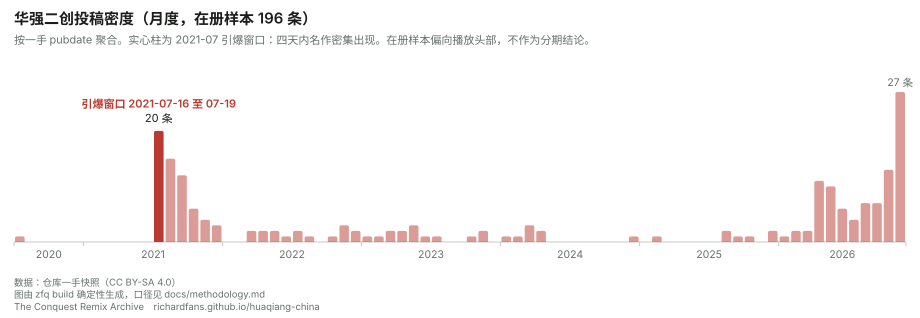
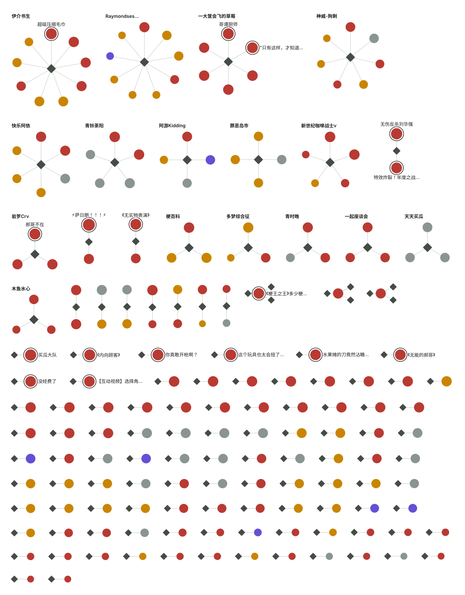

# 🍉 征服二创宇宙档案 · The Conquest Remix Archive

> 《征服》(2003) 二创生态的**收集 · 整理 · 跟踪**——这个梗火了五年，还没人给它记账。
> 人类对华强的开发不足 0.1%，本档案负责记账。
> **English? → [README.en.md](README.en.md)** ｜ 🌐 站点 / Site：[richardfans.github.io/huaqiang-china](https://richardfans.github.io/huaqiang-china/)

[](https://richardfans.github.io/huaqiang-china/)
[](docs/decisions/0009-development-metric.md)
[](https://github.com/RichardFans/huaqiang-china/actions/workflows/ci.yml)
[](LICENSE.content)

<p align="center">
  
</p>

## 🍉 这是什么

2026 年 11 月，作者又一次在B站刷到新的华强买瓜二创——从《萨日朗》到 AI 翻唱，
五年过去，这个梗还在长出新的形态，却没有任何一份系统的档案。

本项目想做的不是技术演示，而是一件更简单的事：把这段正在发生的互联网文化
**整理**清楚、持续**跟踪**它的演化，并把它**分享**给更多人——包括B站之外的世界。
手段恰好是开源的：每条数据带快照证据链，每个榜单由管线从数据生成、可复现。

## 🧑‍💻 关于作者

作者是一名B站大会员，看华强二创下饭多年。本项目为爱发电、非商业、无任何平台
官方背景；立项原因无他：喜欢，且觉得该有人做。

发现错漏，或想以 UP主 身份校对自己的条目？欢迎提 issue：
[投稿收录](.github/ISSUE_TEMPLATE/submit_video.yml) ·
[勘误校对](.github/ISSUE_TEMPLATE/correction.yml) ·
[申请下架](.github/ISSUE_TEMPLATE/takedown.yml)。

<!-- zfq:generated:start -->
**在册 196 条二创**（殿堂 17 · 热门 133 · 新晋 46 · 种子 0）｜ 人工复核 0 · 待复核 196（⚠）｜ 数据快照 2026-11-24（UTC）
> 民间口径：人类对华强的开发不足 0.1%。本档案想算一个可复算的版本，结果撞上天花板：平台检索每个关键词最多只给看 1,000 条（5 个关键词实测封顶）。分母不可知，账面已入册 196 条，照记不误（[ADR-0009](docs/decisions/0009-development-metric.md)）

## 🏆 殿堂级总榜（播放 ≥ 1000 万，共 17 条）
| # | 作品 | UP主 | 发布 | 播放 | 硬币 | 形态 | 桥段 |
|---|---|---|---|---|---|---|---|
| 1 | [⚡萨 日 朗！！！⚡](https://www.bilibili.com/video/BV15L411p7M8) ⚠ | [夜雨星繁y](https://space.bilibili.com/39422678) | 2021-07 | 51,183,169 | 1,316,884 | 剧情剪辑 | 华强买瓜 |
| 2 | [无 伤 反 杀 刘 华 强](https://www.bilibili.com/video/BV1qb4y1z7ve) ⚠ | [特效小哥studio](https://space.bilibili.com/3066511) | 2021-08 | 24,044,499 | 593,823 | 剧情剪辑 | 华强买瓜 |
| 3 | [买 瓜 大 队](https://www.bilibili.com/video/BV1CU4y137FJ) ⚠ | [小猪要吃好果子](https://space.bilibili.com/445423006) | 2021-07 | 22,972,010 | 244,441 | 剧情剪辑 | 华强买瓜 |
| 4 | [《内 向 顾 客》](https://www.bilibili.com/video/BV1Wv411n7FK) ⚠ | [无牙人](https://space.bilibili.com/509993026) | 2021-07 | 15,952,120 | 216,760 | 剧情剪辑 | 华强买瓜 |
| 5 | [你 真 敢 开 枪 啊 ？](https://www.bilibili.com/video/BV17w411R7Eb) ⚠ | [干物快乐宅](https://space.bilibili.com/2074416895) | 2021-07 | 15,261,910 | 74,496 | 剧情剪辑 | 华强买瓜 |
| 6 | [超 级 压 缩 毛 巾](https://www.bilibili.com/video/BV1184y1W79V) ⚠ | [伊介书生](https://space.bilibili.com/91790758) | 2022-12 | 15,026,620 | 175,376 | 剧情剪辑 | 华强买瓜 |
| 7 | [郝 哥 不 在](https://www.bilibili.com/video/BV1RwdhBmE3M) ⚠ | [岩罗Crv](https://space.bilibili.com/438256074) | 2026-04 | 14,923,515 | 412,743 | 剧情剪辑 | 华强买瓜 |
| 8 | [哥 谭 厨 师](https://www.bilibili.com/video/BV1Sf4y1T78M) ⚠ | [一大筐会飞的草莓](https://space.bilibili.com/36438715) | 2021-11 | 14,175,604 | 129,841 | 剧情剪辑 | 华强买瓜 |
| 9 | [《无实物表演》](https://www.bilibili.com/video/BV1NhRMBiEcy) ⚠ | [酸奶煎个蛋](https://space.bilibili.com/50391034) | 2026-05 | 14,170,101 | 64,703 | 剧情剪辑 | 华强买瓜 |
| 10 | [特效炸裂！年度之战！特效小哥大战建模小哥4](https://www.bilibili.com/video/BV1k34y1z7Y6) ⚠ | [特效小哥studio](https://space.bilibili.com/3066511) | 2021-12 | 13,541,465 | 2,253,931 | 剧情剪辑 | 华强买瓜 |
| 11 | [这个玩具也太会扭了吧！根本停不下来~哈哈哈哈](https://www.bilibili.com/video/BV1vv411P7CJ) ⚠ | [机智的Kason](https://space.bilibili.com/8549577) | 2021-09 | 12,634,776 | 158,798 | 剧情剪辑 | 华强买瓜 |
| 12 | ["只有这样，才知道你比的是厨师比赛"](https://www.bilibili.com/video/BV1kx4y1V78T) ⚠ | [一大筐会飞的草莓](https://space.bilibili.com/36438715) | 2023-02 | 12,190,149 | 263,686 | 剧情剪辑 | 华强买瓜 |
| 13 | [水果摊的刀竟然沾糖水？](https://www.bilibili.com/video/BV1RyAVecEJA) ⚠ | [周小闹是周小闹](https://space.bilibili.com/3546640096954436) | 2025-02 | 11,777,166 | 2,064 | 剧情剪辑 | 华强买瓜 |
| 14 | [《无能的郝哥》](https://www.bilibili.com/video/BV1kLRXBsE84) ⚠ | [增殖的发呆](https://space.bilibili.com/13641305) | 2026-05 | 11,569,395 | 108,889 | 剧情剪辑 | 华强买瓜 |
| 15 | [《梗王之王》多少梗，快来快来数一数，24678...](https://www.bilibili.com/video/BV1Ku411B7XR) ⚠ | [谭乔](https://space.bilibili.com/330415548) | 2022-03 | 11,253,196 | 215,975 | 剧情剪辑 | 华强买瓜 |
| 16 | [没 经 费 了](https://www.bilibili.com/video/BV1sP4y1W7Yt) ⚠ | [康师傅红烧甜不辣](https://space.bilibili.com/32837037) | 2021-08 | 10,722,548 | 289,987 | 剧情剪辑 | 华强买瓜 |
| 17 | [【互动视频】选择角色，结局由你来定！](https://www.bilibili.com/video/BV1vb4y1r7cg) ⚠ | [Captive柠檬](https://space.bilibili.com/398622703) | 2021-08 | 10,264,549 | 234,473 | 剧情剪辑 | 华强买瓜 |

## 🍉 华强买瓜 · Top 10
| # | 作品 | UP主 | 发布 | 播放 | 硬币 | 形态 | 桥段 |
|---|---|---|---|---|---|---|---|
| 1 | [⚡萨 日 朗！！！⚡](https://www.bilibili.com/video/BV15L411p7M8) ⚠ | [夜雨星繁y](https://space.bilibili.com/39422678) | 2021-07 | 51,183,169 | 1,316,884 | 剧情剪辑 | 华强买瓜 |
| 2 | [无 伤 反 杀 刘 华 强](https://www.bilibili.com/video/BV1qb4y1z7ve) ⚠ | [特效小哥studio](https://space.bilibili.com/3066511) | 2021-08 | 24,044,499 | 593,823 | 剧情剪辑 | 华强买瓜 |
| 3 | [买 瓜 大 队](https://www.bilibili.com/video/BV1CU4y137FJ) ⚠ | [小猪要吃好果子](https://space.bilibili.com/445423006) | 2021-07 | 22,972,010 | 244,441 | 剧情剪辑 | 华强买瓜 |
| 4 | [《内 向 顾 客》](https://www.bilibili.com/video/BV1Wv411n7FK) ⚠ | [无牙人](https://space.bilibili.com/509993026) | 2021-07 | 15,952,120 | 216,760 | 剧情剪辑 | 华强买瓜 |
| 5 | [你 真 敢 开 枪 啊 ？](https://www.bilibili.com/video/BV17w411R7Eb) ⚠ | [干物快乐宅](https://space.bilibili.com/2074416895) | 2021-07 | 15,261,910 | 74,496 | 剧情剪辑 | 华强买瓜 |
| 6 | [超 级 压 缩 毛 巾](https://www.bilibili.com/video/BV1184y1W79V) ⚠ | [伊介书生](https://space.bilibili.com/91790758) | 2022-12 | 15,026,620 | 175,376 | 剧情剪辑 | 华强买瓜 |
| 7 | [郝 哥 不 在](https://www.bilibili.com/video/BV1RwdhBmE3M) ⚠ | [岩罗Crv](https://space.bilibili.com/438256074) | 2026-04 | 14,923,515 | 412,743 | 剧情剪辑 | 华强买瓜 |
| 8 | [哥 谭 厨 师](https://www.bilibili.com/video/BV1Sf4y1T78M) ⚠ | [一大筐会飞的草莓](https://space.bilibili.com/36438715) | 2021-11 | 14,175,604 | 129,841 | 剧情剪辑 | 华强买瓜 |
| 9 | [《无实物表演》](https://www.bilibili.com/video/BV1NhRMBiEcy) ⚠ | [酸奶煎个蛋](https://space.bilibili.com/50391034) | 2026-05 | 14,170,101 | 64,703 | 剧情剪辑 | 华强买瓜 |
| 10 | [特效炸裂！年度之战！特效小哥大战建模小哥4](https://www.bilibili.com/video/BV1k34y1z7Y6) ⚠ | [特效小哥studio](https://space.bilibili.com/3066511) | 2021-12 | 13,541,465 | 2,253,931 | 剧情剪辑 | 华强买瓜 |

→ 全部 112 条：[docs/lists/scene-maigua.md](docs/lists/scene-maigua.md) ｜ [站点切面](https://richardfans.github.io/huaqiang-china/scene/maigua/)

## 🍜 宋老虎请客 · Top 10
| # | 作品 | UP主 | 发布 | 播放 | 硬币 | 形态 | 桥段 |
|---|---|---|---|---|---|---|---|
| 1 | [胡 言 乱 语](https://www.bilibili.com/video/BV15q4y197TJ) ⚠ | [小朱佩琪66](https://space.bilibili.com/430362460) | 2021-08 | 7,713,127 | 82,346 | 剧情剪辑 | 宋老虎请客 |
| 2 | [华强见宋老虎 但是唱跳RAP 【多梦综合征】【AI音乐宇宙】](https://www.bilibili.com/video/BV1Hy4k64Erk) ⚠ | [多梦综合征](https://space.bilibili.com/110071473) | 2026-08 | 7,080,468 | 256,204 | 剧情剪辑 | 宋老虎请客、华强买瓜 |
| 3 | [【梗百科】控告律师是啥梗？扣税国王的后继梗？](https://www.bilibili.com/video/BV1dA4m1c7XM) ⚠ | [梗百科](https://space.bilibili.com/1544008396) | 2024-04 | 6,010,039 | 4,603 | 剧情剪辑 | 宋老虎请客 |
| 4 | [这是我弟弟 我的刀盾](https://www.bilibili.com/video/BV1vnftBUErw) ⚠ | [伊介书生](https://space.bilibili.com/91790758) | 2026-02 | 4,502,183 | 11,444 | 剧情剪辑 | 宋老虎请客 |
| 5 | [原始人，起洞！](https://www.bilibili.com/video/BV1iu4y1f7SZ) ⚠ | [黑猫的泪水](https://space.bilibili.com/111161461) | 2023-05 | 4,435,674 | 24,158 | 剧情剪辑 | 宋老虎请客 |
| 6 | [这是我弟弟吴京](https://www.bilibili.com/video/BV1QWaCzBE5Q) ⚠ | [伊介书生](https://space.bilibili.com/91790758) | 2025-09 | 4,161,779 | 17,434 | 剧情剪辑 | 宋老虎请客 |
| 7 | [贾斯汀 · 比瓜](https://www.bilibili.com/video/BV1tv41137Th) ⚠ | [潮汕好男人](https://space.bilibili.com/19071708) | 2021-09 | 4,121,092 | 145,869 | 剧情剪辑 | 宋老虎请客 |
| 8 | [【梗百科】私人音效是啥梗？](https://www.bilibili.com/video/BV1cw4m1m7uZ) ⚠ | [梗百科](https://space.bilibili.com/1544008396) | 2024-04 | 3,396,013 | 2,017 | 剧情剪辑 | 宋老虎请客 |
| 9 | [郝 哥 面 馆](https://www.bilibili.com/video/BV1RMGP6iE6E) ⚠ | [乌贼酱](https://space.bilibili.com/242014) | 2026-07 | 2,625,301 | 21,950 | 剧情剪辑 | 宋老虎请客 |
| 10 | [强子刚来啊，等你二十年了【AI MV大赛】](https://www.bilibili.com/video/BV1LcxE61Euj) ⚠ | [Raymondsese](https://space.bilibili.com/1298657234) | 2026-10 | 2,535,746 | 22,740 | AI其他 | 宋老虎请客 |

→ 全部 51 条：[docs/lists/scene-song-laohu-banquet.md](docs/lists/scene-song-laohu-banquet.md) ｜ [站点切面](https://richardfans.github.io/huaqiang-china/scene/song-laohu-banquet/)

## 🔪 封彪桥段 · 全部 7 条
| # | 作品 | UP主 | 发布 | 播放 | 硬币 | 形态 | 桥段 |
|---|---|---|---|---|---|---|---|
| 1 | [快点吃，一会儿华强该来了](https://www.bilibili.com/video/BV1iA411F7N5) ⚠ | [烹鲤鱼](https://space.bilibili.com/2045439) | 2021-09 | 3,220,259 | 2,421 | 剧情剪辑 | 封彪桥段 |
| 2 | [电视剧《征服》中那些黑老大们的原型，封彪真的下跪叫爷爷了吗？](https://www.bilibili.com/video/BV1Af4y1d7fv) ⚠ | [胆子不小的郑吉祥](https://space.bilibili.com/405036467) | 2020-07 | 2,889,818 | 15,876 | 剧情剪辑 | 封彪桥段 |
| 3 | [奥德修斯，跟我牛来拼你有这个实力吗？！](https://www.bilibili.com/video/BV1ZE8H6eE5W) ⚠ | [阿游Kidding](https://space.bilibili.com/1650750) | 2026-08 | 2,629,964 | 16,010 | 剧情剪辑 | 封彪桥段 |
| 4 | [爷料定不中用](https://www.bilibili.com/video/BV1d6421c7uT) ⚠ | [关节拉伤](https://space.bilibili.com/1324510) | 2024-03 | 1,121,610 | 5,726 | 剧情剪辑 | 封彪桥段 |
| 5 | [听说你这段时间一直在找我！](https://www.bilibili.com/video/BV1rxbAzPEWy) ⚠ | [GK影视Cut](https://space.bilibili.com/1700797777) | 2025-08 | 1,085,646 | 341 | 剧情剪辑 | 封彪桥段 |
| 6 | [各位郝哥 节目叫《非常骚扰》](https://www.bilibili.com/video/BV1VWGJ6kEKo) ⚠ | [韩历飞羽666](https://space.bilibili.com/1172349285) | 2026-05 | 301,174 | 2,036 | 剧情剪辑 | 封彪桥段 |
| 7 | [葫芦恶霸【AI MV大赛】](https://www.bilibili.com/video/BV1QHYP6JEmh) ⚠ | [Raymondsese](https://space.bilibili.com/1298657234) | 2026-10 | 282,082 | 183 | AI其他 | 封彪桥段 |

## 📅 编年速览
| 年份 | 在册 | 形态构成 | 年度之最 |
|---|---|---|---|
| 2020 | 1 | 剧情剪辑×1 | [电视剧《征服》中那些黑老大们的原型，封彪真的下跪叫爷爷了吗？](https://www.bilibili.com/video/BV1Af4y1d7fv) |
| 2021 | 60 | 剧情剪辑×54 · 鬼畜调教×6 | [⚡萨 日 朗！！！⚡](https://www.bilibili.com/video/BV15L411p7M8) |
| 2022 | 16 | 剧情剪辑×13 · 鬼畜调教×3 | [超 级 压 缩 毛 巾](https://www.bilibili.com/video/BV1184y1W79V) |
| 2023 | 14 | 剧情剪辑×14 | ["只有这样，才知道你比的是厨师比赛"](https://www.bilibili.com/video/BV1kx4y1V78T) |
| 2024 | 8 | 剧情剪辑×8 | [【梗百科】扣税“国王”是啥梗？听好了！乡巴佬？！！](https://www.bilibili.com/video/BV1fJ4m1e7Gv) |
| 2025 | 7 | 剧情剪辑×7 | [水果摊的刀竟然沾糖水？](https://www.bilibili.com/video/BV1RyAVecEJA) |
| 2026 | 90 | 剧情剪辑×73 · AI翻唱/语音克隆×8 · 鬼畜调教×6 · AI其他×3 | [郝 哥 不 在](https://www.bilibili.com/video/BV1RwdhBmE3M) |

> 一手 pubdate 已见 **2021-07-16 至 19 四天引爆窗口**（《买瓜大队》《内向顾客》《萨日朗》密集出现）；2026 样本出现平台「疑似AI合成」标注作品。分期结论待 pubdate 深页补采后定稿：[编年初稿](reports/chronicle-draft.md) · [方法学](docs/methodology.md)。⚠=待人工复核（[ADR-0006](docs/decisions/0006-review-gate.md)）。

## 🕸 创作者星图
137 位创作者与 196 部在册作品，分成 126 个互不相连的创作单元，其中 26 位 有 2 部以上在册作品。圆点是作品（大小随播放量、颜色是桥段），菱形是创作者，虚线是平台标注的合作关系（参演 4、后期 2、文案 2、剪辑 1、赞助商 1、配音 1）。

<p align="center"></p>

→ 可筛选、可悬停的交互版：[站点图谱页](https://richardfans.github.io/huaqiang-china/graph/)。边只来自确定性字段，每条带证据（[ADR-0008](docs/decisions/0008-knowledge-graph.md)）。
<!-- zfq:generated:end -->

## 📡 订阅

- 新收录 RSS（中文）`/feeds/new.rss.xml` ｜ New entries RSS (EN) `/feeds/new.en.rss.xml`
- 周涨幅榜 `/feeds/movers.rss.xml` ｜ Atom `/feeds/atom.xml` ｜ JSON Feed `/feeds/feed.json`
- 仓库内完整切面：[docs/lists/](docs/lists/)（桥段 / UP主 / 分级，自动生成）

## 🚀 快速开始（开发者）

```bash
uv venv .venv && uv pip install --python .venv/Scripts/python.exe requests pydantic jsonschema pytest
# 或：python -m pip install requests pydantic jsonschema pytest

export PYTHONPATH=tools   # Windows PowerShell: $env:PYTHONPATH='tools'
python -m zfq.validate     # 质量门禁 R1-R7（无需联网）
python -m pytest -q        # 测试
python -m zfq.track        # 跟踪刷新（联网，限速 1 req/s）
python -m zfq.build        # 重建视图/列表/README/订阅源/站点数据
```

站点（本地）：`cd site && npm install && npm run build` → `site/dist/`（纯静态）。
部署与站点地址配置见 [CONTRIBUTING.md](CONTRIBUTING.md)。

## 🗂 治理与导览

| 路径 | 内容 |
|---|---|
| `data/vocabulary.md` | 规范词表（canonical 名 + 变体/错写映射，检索的基石） |
| `data/entries/` `data/creators/` | 档案本体（每视频/每 UP 主一 JSON，带快照证据链） |
| `data/candidates/` | 拒绝日志——「为什么没收录」也是档案 |
| `docs/decisions/` | ADR ×9：收录 / 合规 / 命名 / 选型 / 发现 / 评审门控 / 封面链接 / 图谱 / 开发度 |
| `docs/methodology.md` `docs/verification.md` | 分期方法（预先注册）与验证协议 |
| `reports/` | 编年初稿 / 跟踪报告 / 交叉验证记录 |
| `tools/zfq/` | 数据管线（限速客户端 · 入册 · 跟踪 · 校验 · 构建 · issuebot） |
| `site/` | Astro 5 双语静态站 + 订阅源 |

**本 README 的全部榜单由 `zfq build` 自动生成**（数据即唯一事实源）；改数据后重跑 build，
CI 的 R7 规则会拦截「README 与数据不一致」的提交。

## ⚖️ 采集合规（重要）

本项目**不复刻、不分发平台的访问控制/签名机制**，仅以浏览器等价方式访问公开页面与端点，
仅收录元数据、默认限速、遇风控退避降级，并提供
[下架通道](.github/ISSUE_TEMPLATE/takedown.yml)（72 小时处置承诺）。背景（含
bilibili-API-collect 律师函事件与 robots.txt 留档）：[ADR-0002](docs/decisions/0002-collection-legal-posture.md)。

## 🤖 自动化

GitHub Actions：`ci`（门禁+站点构建+Pages 部署）· `track`（每日刷新 → 自动 PR）·
`discover`（每周发现 → 待评审 PR）· `issue-bot`（提交视频 issue → 实时校验 → PR）。
新条目默认 `review=pending`（[ADR-0006 评审门控](docs/decisions/0006-review-gate.md)），
榜单以「⚠」明示待复核状态。

## 📄 许可

- 代码：MIT ｜ 内容与数据：[CC BY-SA 4.0](LICENSE.content)
- 视频内容版权归原权利人与创作者所有；本仓库不存储任何音视频字节。
